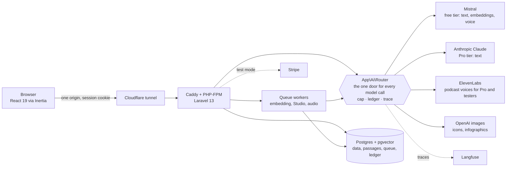

# Better NotebookLM

A working clone of Google's NotebookLM: add sources, ask questions, and get answers grounded in those sources, with citations
that jump to the exact passage. It was built between 17 and 20
November 2026 as a job application test, by one developer directing a team of AI agents.

**Live demo:** https://betternotebookllm.tartarus-vault.com (by invitation: testers have a link).

## What works

- **Sources:** PDF or text files, web pages and pasted text. Each gets a viewer and a short summary. A web page is read as plain
  HTML: a page with almost no readable text (one built by JavaScript, say) fails with a clear message instead of becoming an empty
  source. Uploads are limited by
  `SOURCE_MAX_FILE_KB`: 20 MB by default, and the live demo sets it to 50 MB. A large source is accepted with a warning of the time
  and cost it takes. Checkboxes choose which sources the chat and the Studio use.
- **Grounded chat:** answers stream, come only from the checked sources, and say so when the sources don't hold the answer.
  Citations are **validated in code**: a `[P12]` survives only if passage 12 was actually in that prompt, and clicking it scrolls to
  the passage and highlights it.
- **Notebook overview:** a summary of the checked sources and three suggested questions.
- **Notes:** write your own, or "Save to note" from a chat answer or a report. A note can be used as a source.
- **The Studio,** generated in the background:
  - **audio overview:** a two-host podcast in four formats (Deep Dive, Brief, Critique, Debate); Pro users and invited testers
    can swap one host for one of four personas (archetypes, no real person imitated, no voice cloning), voiced by ElevenLabs;
  - **reports:** briefing document, study guide and FAQ, cited;
  - **mind map:** an expandable tree whose nodes cite their passages;
  - **quiz:** 5 to 8 questions with hints and cited explanations;
  - **slide deck:** 7 fixed templates the model fills, checked against a contract, presentable full screen and downloadable as .pptx;
  - **infographic** (Pro and testers): a cited brief, then one image drawn from that brief alone by OpenAI's image model, then a
    review step in which the text model that wrote the brief compares the picture with it; a bad picture is redrawn once, and the verdict is shown with the
    item. Off unless `INFOGRAPHICS_ENABLED` is set;
  - each item shows which model and plan made it (for example Claude Sonnet · Pro, Mistral Small · Free);
  - a **Customize** step before each: language, sources, a focus, the kind's own option, and the estimated cost.
- **Notebook icons:** an optional generated image per notebook (an emoji when it is off or fails).
- **Pricing:** Free, Pro and "Own key". Pro is bought through **Stripe's checkout in test mode** with Stripe's public test card: no
  money moves, and a verified webhook grants 30 days of Pro.
- **Sign-in:** by invitation only (a single-use link), or Google for invited addresses; passkeys and optional two-factor.
- **Honest limits:** the first screen says it is a demo, shows your budget, and what a podcast costs you.
- **A welcome for reviewers:** invited reviewers get a greeting and a short guided checklist in German; everyone else sees the plain
  app. The interface itself is in English.
- **About:** a public page on who built it and how.
- **Error monitoring:** a Sentry hook, errors only and off without a DSN. Before an event leaves, the error class, the file and line, the
  route's path and the user's id are kept, and the message, the request body, cookies and headers are dropped.

**Not in this demo** (most are shown greyed in the app): video overviews, flashcards, data tables and sites; YouTube, audio, image and Google Drive sources; web research and full web scraping; chat settings; sharing between users; and using your own API key. Chat history is kept in your browser only.

## Architecture



- **One app, not two.** Laravel 13 serves the React pages through Inertia: one origin, one sign-in, no separate API to keep in step.
- **One door for AI.** Every model call goes through `App\Ai\Router` (`src/app/Ai/Router.php`). Before a call it reserves the worst-case
  cost and refuses it if the user's monthly cap or the app's cap would be crossed; after it, it writes a ledger row and a Langfuse trace.
  No request field can choose a model, a voice or a prompt: the **tier decides the model, in config**.
- **Search.** Passages and their embeddings live in the same Postgres. Small notebooks are sent whole; larger ones use hybrid search:
  vector similarity and full-text, fused by reciprocal rank in one SQL query (`src/app/Chat/Retriever.php`).
- **Untrusted text stays data.** Everything a source or a user wrote reaches a model inside a CDATA block it cannot close, labelled as
  data, and a `[P12]` typed into a source can't pose as a citation. Structured answers are parsed and checked in code, with one repair
  call at most. Nothing a model writes is rendered as HTML.
  Web sources are fetched through a guard against server-side request forgery.
- **Deploy.** A Docker image (`deploy/`) built from one clean commit: the app, two queue workers, a scheduler, Postgres and a Cloudflare
  tunnel, each memory-capped and with its logs capped at 30 MB, on a Hetzner server, with no port opened on the server.

Every model call, what it is given, what its prompt says and what the code checks, is mapped in [`process/ai-map.md`](process/ai-map.md).

## Run it locally

Needs PHP 8.3+, Composer, Node and Docker (for Postgres with pgvector).

```bash
docker compose -f deploy/compose.dev.yaml up -d db
cd src && composer install && npm ci && cp -n .env.example .env && php artisan key:generate && php artisan migrate
composer run dev
```

`composer run dev` starts the server, the queue worker and Vite together. Model calls need keys in `src/.env` (Mistral at least;
the others are optional). Keys never go in code.

```bash
cd src && npm run build && php artisan test
```

Tests use the `laravel/ai` fakes only: no test makes a real model call. Lint and types:
`vendor/bin/pint --test && npm run check && npm run types:check`. More in [`AGENTS.md`](AGENTS.md).

## How it was built

By AI agents, each with one job, under one developer's direction: a coordinating agent wrote the briefs, builders worked one feature
each in their own branch, and a reviewing agent had to prove every finding, with a failing test or a quoted line, before it counted. The method, the
decisions that shaped the product, the code review report and the parity research are in [`process/`](process/README.md).

## Licence

MIT: see [`LICENSE`](LICENSE).

Built by the AI Swarm of Guillermo Ernesto Arce Stumpf - Ouroboros Creative Collective.
